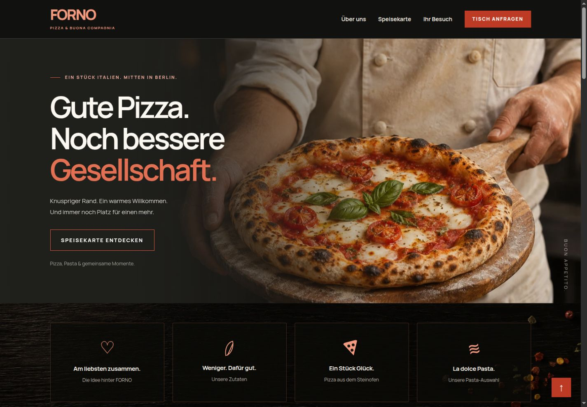
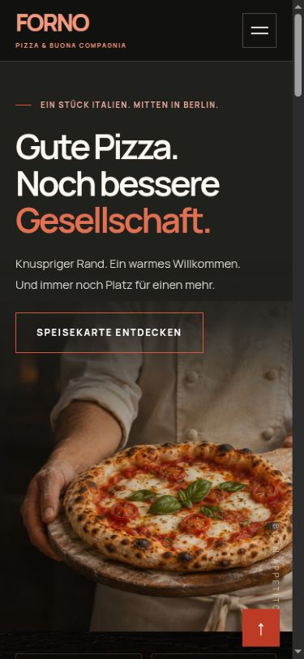

# FORNO — Pizza & gute Gesellschaft

Ein deutschsprachiger Pizzeria-Landingpage-Konzeptentwurf: schwarze Holzstruktur mit dezentem Mehl und Gewürzen, eine dunkle Navigation und tomatenrote Akzente. Einladende Bildsprache und eine übersichtliche Speisekarte verbinden italienisches Lebensgefühl mit einem familienfreundlichen Auftritt.

**Portfolio-Projekt von Olha Khodakivska.** FORNO ist in diesem Projekt ein fiktives Restaurant. Adresse, Telefonnummer, Öffnungszeiten und Preise sind Demonstrationsangaben. Es können keine echten Reservierungen oder Bestellungen aufgegeben werden.

## Vorschau





## Inhalt und Funktionen

- Ein eigenständiger Landingpage-Aufbau mit Hero, Themenlinks, Restaurantgeschichte, Zutaten, Speisekarte und Besuchsinformationen.
- Deutsche Texte und beispielhafte Preise in Euro.
- Getränkekarte mit Säften, Cappuccino, Tee, Coca-Cola, Espresso und Hauslimonade; vier passende Getränkefotos und Portionsgrößen.
- Responsive Layouts und mobiles Aufklappmenü.
- Interaktive Speisekarte mit Pizza, Pasta, Dolci und Getränke.
- Demo-Anfrageformular mit Namen, E-Mail, Datum, Uhrzeit, Gruppengröße und optionalen Wünschen.
- Montag als Ruhetag; Di–Do Anfragezeiten von 17:00 bis 21:30, Fr–So von 12:00 bis 21:30 in Halbstundenschritten. Schließzeit ist 22:00 Uhr; vergangene Uhrzeiten und Zeiten außerhalb der Öffnung werden ausgeschlossen.
- Zusätzliches Restaurantfoto mit gedecktem Tisch, Pizza, Saft und Espresso.
- Native Dialoge mit Fokus-Rückgabe, Escape-Taste und deutlich beschrifteten Eingabefeldern.
- Leichte Zoom-out-Animation des Hero-Bildes mit Unterstützung von `prefers-reduced-motion`.
- Neun eigens KI-generierte Bildmotive, lokal als WebP eingebunden.
- Lokal gehostete Manrope-Schrift und eigenes Favicon.

## Demo statt echter Buchung

Das Formular prüft die Angaben ausschließlich im Browser. Es gibt keine Serververbindung, keinen E-Mail-Versand, keine dauerhafte Speicherung und keine echte Verfügbarkeitsprüfung. Angezeigte Zeitfenster richten sich nur nach den Beispiel-Öffnungszeiten. Eine erfolgreiche Prüfung reserviert keinen Tisch.

Die Demonstrationsnummer startet keinen Anruf, sondern öffnet einen erklärenden Hinweis. Die Adresse ist ausdrücklich fiktiv; es ist keine Karte eingebettet.

## Technischer Aufbau

HTML5, CSS3 und Vanilla JavaScript. Keine Frameworks, npm-Abhängigkeiten oder Build-Schritte. Außer den lokalen Dateien werden für den Betrieb keine externen Ressourcen angefragt.

```text
forno-pizzeria/
├── index.html
├── style.css
├── script.js
├── favicon.png
├── fonts/
│   └── manrope-latin.woff2
├── images/
│   ├── hero.webp
│   ├── margherita.webp
│   ├── trattoria.webp
│   ├── dark-wood.webp
│   ├── pizza-table.webp
│   ├── drink-juice.webp
│   ├── drink-coffee.webp
│   ├── drink-tea.webp
│   └── drink-cola.webp
├── docs/
│   ├── image-prompts.md
│   └── screenshots/
│       ├── desktop.png
│       └── mobile.png
└── README.md
```

## Lokal ansehen

In VS Code mit **Live Server** öffnen oder im Projektordner ausführen:

```bash
python3 -m http.server 5520
```

Dann [http://localhost:5520](http://localhost:5520) öffnen.

## Auf GitHub Pages veröffentlichen

Das Projekt einschließlich Bilder, Schriften und Screenshots pushen. Unter **Settings → Pages** als Quelle **Deploy from a branch**, den passenden Branch und **/ (root)** wählen. Alle lokalen Ressourcen verwenden relative Pfade.

## Gestaltung & Bildnachweis

Visuelle Inspiration: [Family Friendly Pizza Restaurant, Nicepage](https://nicepage.com/website-templates/preview/family-friendly-pizza-restaurant-4694183). Dieses Projekt verwendet eigenständige Texte, Gestaltung und eigenen Code; es werden keine Nicepage-Bilddateien oder Template-Dateien übernommen.

Die neun Bildmotive wurden mit dem integrierten Bildgenerator erstellt. Sie zeigen keine tatsächlichen Speisen, Mitarbeiter oder Räume eines realen Restaurants. Die finalen Prompts sind in [docs/image-prompts.md](docs/image-prompts.md) dokumentiert.

Manrope: Open-Source-Schrift, ursprünglich über Google Fonts bezogen und hier lokal eingebunden. Vor der Verwendung für einen echten Gastronomiebetrieb müssen dessen Daten, Speisekarte, Allergenauskünfte, rechtliche Informationen sowie ein passender Anfrage-Endpunkt ergänzt werden.
